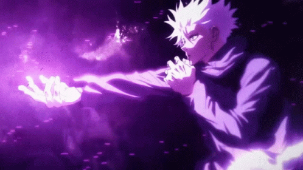

  

  <h3>⚡ 「天上天下唯我独尊」 · <em>"Throughout Heaven and Earth, I alone am the honored one."</em> ⚡</h3>

  

    
    
    
    
  

  

    
    &nbsp;
    
    &nbsp;
    
  

---

<table width="100%">
  <tr>
    <td width="55%" valign="middle">
      <h3>📜 Sorcerer Dossier // 術師調書</h3>
      <pre lang="json">
{
  "Sorcerer": "Phan Van Toan (Giáo)",
  "Grade": "Special Grade Simulation Engineer (特級)",
  "Domain": "The Giáo Archive (WebGL 3D Chamber)",
  "Cursed_Energy": "Gazebo / Isaac Sim · ROS 2 · Three.js",
  "Mission": "Simulating infinite trajectories before hardware touches reality"
}
      </pre>
    </td>
    <td width="45%" align="center" valign="middle">
       
      <em>Domain Expansion: Infinite Void // 無量空処</em>
    </td>
  </tr>
</table>

---

## 🌌 領域展開 // DOMAIN EXPANSION: THE 3D SPATIAL CHAMBER

> *"When ordinary graduation invites felt too mundane, I manifested an entire interactive 3D isometric memory domain in WebGL."*

  

  👉 <strong><a href="https://the-giao-archive.vercel.app/" target="_blank">Step inside: The Giáo Archive (Interactive 3D Realm) ↗</a></strong> 
  Orbit 360° · Toggle desk lamp · Discover memories & easter eggs inside an isometric WebGL space 
  
  
  
  
  

---

## 🔮 生得術式 // INNATE TECHNIQUES & FEATURED EXPANSIONS

### ⚡ 反転術式 // REVERSE CURSED TECHNIQUE: Skills Distillation (Thesis 2026)
*Gradient-free prompt optimization engine distilling agent capabilities for Small Language Models (SLMs).*

<table width="100%">
  <tr>
    <td width="55%" valign="top">
      <ul>
        <li><b>+23.6% peak accuracy boost</b> via automated Teacher → Student → Judge optimization loop.</li>
        <li>Zero weight fine-tuning: pure algorithmic prompt distillation without heavy GPU fine-tuning costs.</li>
        <li>Interactive evaluation matrix & prompt trace telemetry.</li>
      </ul>
      

        
        
        
        
      

      <a href="https://github.com/givoxxs/Skills_Distillation"><strong>GitHub Repository ↗</strong></a> &nbsp;•&nbsp; 
      <a href="https://skills-distillation.vercel.app"><strong>Live Dashboard ↗</strong></a>
    </td>
    <td width="45%" align="center" valign="middle">
      
       
       
      <em>Hollow Purple 200% // 虚式「茈」</em>
    </td>
  </tr>
</table>

 

<table width="100%">
  <tr>
    <td width="50%" valign="top">
      <h3>👁️ 六眼 // SIX EYES PERCEPTION BabyCare AI — Posture & Safety CV</h3>
      
Real-time edge computer vision pipeline detecting infant sleep posture and blanket coverage in sub-50ms.

      <ul>
        <li>MediaPipe 33-point skeletal landmarking + Random Forest/XGBoost classifier.</li>
        <li>Low-latency RTSP streaming alert service containerized in Docker.</li>
      </ul>
      

        
        
        
      

      <a href="https://github.com/givoxxs/baby_posture_analysis"><strong>Explore Repository ↗</strong></a>
    </td>
    <td width="50%" valign="top">
      <h3>🗺️ 呪霊操術 // CURSE MANIPULATION Da Nang Culinary Atlas</h3>
      
Geospatial discovery platform cataloging culinary gems across Vietnam's coastal metropolis.

      <ul>
        <li>Distributed Playwright crawler pipelines + PostgreSQL database.</li>
        <li>Mapbox turn-by-turn routing with native performance in React Native.</li>
      </ul>
      

        
        
        
      

      <a href="https://github.com/givoxxs/Danang-Culinary-Atlas"><strong>Backend ↗</strong></a> &nbsp;•&nbsp; 
      <a href="https://github.com/givoxxs/Danang-Culinary-Atlas-FE"><strong>Frontend ↗</strong></a>
    </td>
  </tr>
</table>

---

## ⚡ 黒閃 // BLACK FLASH ACHIEVEMENTS

- 🏆 **Best Architecture Award** @ Real-World AI Implementation Competition (DEVDAY 2026)
- 🥈 **UniHack Hackathon Finalist** (2024)
- 🎓 **DUT Senior (Enterprise Cooperation Program)** · **GPA: 3.54 / 4.0**

---

## 🧰 術式構成 // CURSED ENERGY & ARSENAL

   

<table width="100%">
  <tr>
    <td width="33%" align="center">
      <b>🌀 Simulation & Spatial</b> 
      ROS 2 · Gazebo · Isaac Sim Three.js · WebGL · Blender
    </td>
    <td width="33%" align="center">
      <b>⚡ Perception & Models</b> 
      PyTorch · OpenCV · MediaPipe Scikit-Learn · Prompt Optimization
    </td>
    <td width="33%" align="center">
      <b>🛡️ Core & Infrastructure</b> 
      C++ · Python · Docker FastAPI · PostgreSQL · Linux
    </td>
  </tr>
</table>

---

  <table>
    <tr>
      <td align="center" style="border: none;">
         
        <em>Malevolent Shrine // 伏魔御廚子</em>
      </td>
      <td align="center" style="border: none;">
         
        <em>Exorcising bugs with coffee ☕</em>
      </td>
    </tr>
  </table>

  <h3>⛩️ 結界術 // BARRIER TECHNIQUES & COMMS LINK</h3>
  

    Have an autonomous flight pipeline to benchmark, a physics simulation world to manifest, 
    or an ambitious 3D spatial experience to build? Let's connect!
  

  

    
    &nbsp;
    
    &nbsp;
    
  

  

  Crafted with ⚡ and Limitless Cursed Energy · Da Nang, Vietnam

