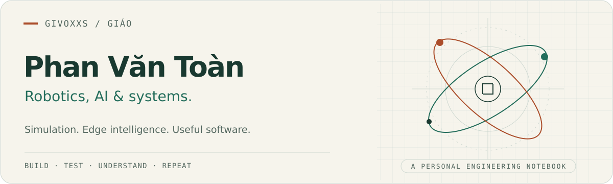

<picture>
  <source media="(prefers-color-scheme: dark)" srcset="assets/header-dark.svg">
  
</picture>

# Hi, I'm Toàn — you can call me Giáo.

I build at the intersection of **robotics, AI, and software systems**: simulation, edge intelligence, and practical tools for developers.

[LinkedIn](https://www.linkedin.com/in/givoxxs/) · [Email](mailto:phanvantoan.contact@gmail.com) · [Explore my repositories](https://github.com/givoxxs?tab=repositories)

### What I work on

- **Robotics & simulation** — ROS 2, Isaac Sim, Gazebo, and the software around robotic systems.
- **AI & edge intelligence** — model evaluation, computer vision, and deployment on constrained hardware.
- **Developer tools & infrastructure** — reproducible workflows, backend services, and useful automation.

**Background:** Information Technology at DUT, University of Danang. Experience at **SOC.ONE** and **VJ Technologies**.

### Selected work

<table>
<tr>
<td valign="top" width="50%">

#### [01 / Skills Distillation](https://github.com/givoxxs/Skills_Distillation)

My 2026 thesis project: rewriting structured skill instructions through a **Teacher → Student → Judge** loop to improve small-model execution, without retraining model weights.

**Python · LLM evaluation · FastAPI · Next.js**

[Code & experiments](https://github.com/givoxxs/Skills_Distillation) · [Dashboard](https://skills-distillation.vercel.app)

</td>
<td valign="top" width="50%">

#### [02 / README Reality Check](https://github.com/givoxxs/readme-reality)

A local-first CLI and GitHub Action that checks README setup instructions against repository evidence: scripts, paths, lockfiles, and environment templates.

**JavaScript / TypeScript tooling · Static analysis · CI**

[Code & usage](https://github.com/givoxxs/readme-reality)

</td>
</tr>
<tr>
<td valign="top" width="50%">

#### [03 / VPP Document Agent](https://github.com/givoxxs/devday_2026_vibeteam)

A team project for DevDay 2026, processing Japanese solar-project documents. My contribution focused on **PDF/image processing and Vision LLM experiments**.

**Python · PDF processing · Vision LLMs**

[Team project & my role](https://github.com/givoxxs/devday_2026_vibeteam#team--vibe-team)

</td>
<td valign="top" width="50%">

#### [04 / Da Nang Culinary Atlas](https://github.com/givoxxs/Danang-Culinary-Atlas)

A culinary discovery backend covering restaurants, dishes, reviews, geographic data, and role-based access.

**Java · Spring Boot · PostgreSQL**

[Backend](https://github.com/givoxxs/Danang-Culinary-Atlas) · [Frontend](https://github.com/givoxxs/Danang-Culinary-Atlas-FE)

</td>
</tr>
</table>

<strong>A result from Skills Distillation</strong>

The repository reports a best observed **23.6% relative score gain** for `slack-gif-creator`, from **0.716 in round 1 to 0.886 at the peak round**, under the project's evaluation setup. This is a peak experimental result; the final-round score was 0.865.

[Evaluation table, methodology, and limitations](https://github.com/givoxxs/Skills_Distillation#kết-quả-thực-nghiệm)

### Tools I use

| Area | Tools |
| --- | --- |
| Languages | Python, C/C++, TypeScript, Java |
| Robotics & edge | ROS 2, Isaac Sim, Gazebo, GAP SDK, PULP SDK |
| AI | PyTorch, TensorFlow, OpenCV, LLM evaluation |
| Software & workflow | FastAPI, Spring Boot, PostgreSQL, Linux, Git, CI |

---

Interested in robotics, edge AI, or building useful tools? [Let's talk.](mailto:phanvantoan.contact@gmail.com)
