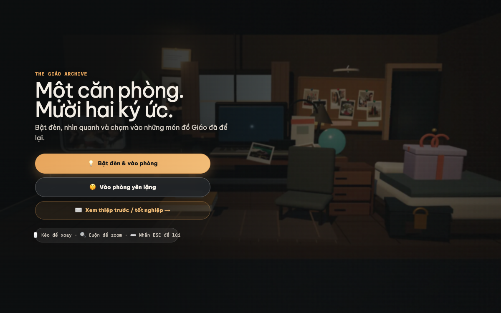
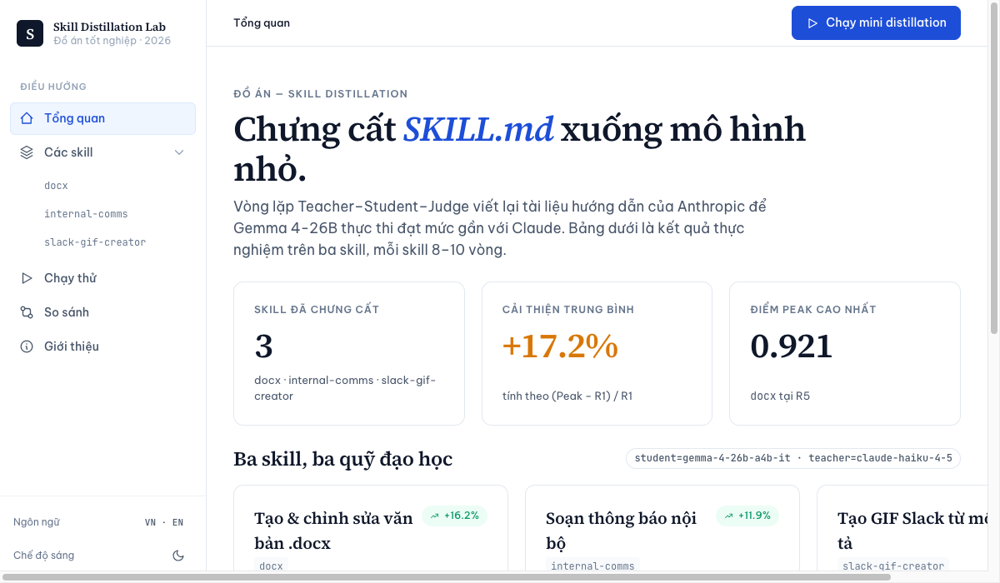

   

  # Hi, I'm Phan Van Toan (Giáo) 👋

  **Robotics Software & Simulation Engineer · Creative Systems Tinkerer** 
  📍 Da Nang, Vietnam

  

    
    &nbsp;
    
    &nbsp;
    
  

  

    <em>"Simulating a million flight trajectories before a robot ever touches reality."</em>
  

---

### ⚡ Quick Highlights
- 🤖 **Simulation & Robotics:** High-fidelity physics, distributed ROS 2 pipelines, and autonomous UAV flight stacks.
- 🎨 **Creative 3D Web:** Interactive WebGL/Three.js spatial rooms and custom developer tools.
- 🏆 **Best Architecture Award** @ Real-World AI Implementation Competition (DEVDAY 2026).
- 🎓 **DUT Senior** (Enterprise Cooperation Program) · **GPA: 3.54 / 4.0**.

---

## 🏛️ The 3D Spatial Chamber — Interactive Graduation Room

*When graduation arrived, sending a static PDF felt too ordinary. So I built an interactive 3D room in WebGL.*

  

  👉 <strong><a href="https://the-giao-archive.vercel.app/" target="_blank">Step inside: The Giáo Archive (Interactive 3D Room) ↗</a></strong> 
  Orbit camera · Toggle desk lamp · Discover memories inside an isometric WebGL world

---

## 🛠️ Featured Projects

<table width="100%">
  <tr>
    <td width="55%" valign="top">
      <h3>🔬 Skills Distillation (2026 Thesis)</h3>
      
Gradient-free prompt optimization distilling agent skills for small models (SLMs).

      <ul>
        <li><b>+23.6% peak gain</b> via Teacher → Student → Judge loop.</li>
        <li>Zero weight fine-tuning; pure automated prompt refinement.</li>
      </ul>
      

        
        
        
      

      <a href="https://github.com/givoxxs/Skills_Distillation">GitHub Repo ↗</a> • <a href="https://skills-distillation.vercel.app">Live Dashboard ↗</a>
    </td>
    <td width="45%" align="center" valign="middle">
      
    </td>
  </tr>
</table>

 

<table width="100%">
  <tr>
    <td width="50%" valign="top">
      <h3>👁️ BabyCare AI — Sleep Safety</h3>
      
Real-time edge CV pipeline monitoring infant posture & blanket coverage.

      <ul>
        <li>MediaPipe 33-point skeletal tracking + Random Forest/XGBoost.</li>
        <li>Low-latency alert streaming via FastAPI service.</li>
      </ul>
      

        
        
        
      

      <a href="https://github.com/givoxxs/baby_posture_analysis">Explore Repo ↗</a>
    </td>
    <td width="50%" valign="top">
      <h3>🗺️ Da Nang Culinary Atlas</h3>
      
Geospatial platform mapping restaurant discovery with real-time navigation.

      <ul>
        <li>Distributed Playwright crawler pipelines + PostgreSQL.</li>
        <li>Mapbox turn-by-turn routing in React Native.</li>
      </ul>
      

        
        
        
      

      <a href="https://github.com/givoxxs/Danang-Culinary-Atlas">Backend ↗</a> • <a href="https://github.com/givoxxs/Danang-Culinary-Atlas-FE">Frontend ↗</a>
    </td>
  </tr>
</table>

---

## 🧰 Tech Arsenal

   
  ROS 2 · Python · C++ · PyTorch · OpenCV · Three.js · React · Next.js · FastAPI · Docker · PostgreSQL · Linux

---

   

  <h3>☕ Want to collaborate or chat?</h3>
  
Always happy to talk robotics simulation, digital twins, or 3D web experiments!

  

    
    &nbsp;
    
    &nbsp;
    
  

  Crafted with 💙 in Da Nang, Vietnam · 2026

