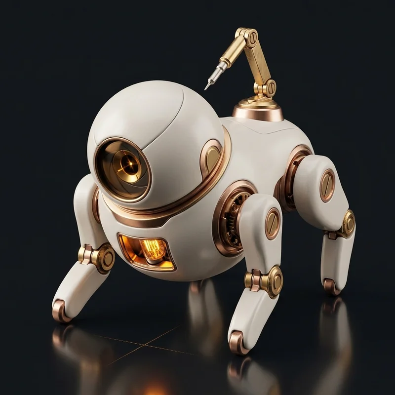

<div align="center">

<picture>
  <source media="(prefers-color-scheme: dark)" srcset="assets/hero_living_diorama.webp">
  
</picture>

<samp><code>DA NANG BAY SECTOR · 02:30 AM DEEP WORK · CALIBRATING SIMULATIONS</code></samp>

# PHAN VĂN TOÀN (GIÁO)
### Robotics Software & Simulation Engineer · Creative 3D Systems Developer
**Senior IT @ Da Nang University of Science and Technology (DUT) · GPA 3.54 / 4.0**

> *"Simulating infinite trajectories before hardware touches reality."*

<p>
  <a href="https://github.com/givoxxs">
    
  </a>
  &nbsp;
  <a href="https://www.linkedin.com/in/givoxxs/">
    
  </a>
  &nbsp;
  <a href="mailto:phanvantoan.contact@gmail.com">
    
  </a>
</p>

### 🧭 DIORAMA WORKBENCH DIRECTORY
*Explore the four core engineering zones modeled in the studio diorama:*

<p>
  <a href="https://skills-distillation.vercel.app">
    
  </a>
  &nbsp;
  <a href="https://github.com/givoxxs">
    
  </a>
  <br>
  <a href="https://github.com/givoxxs/baby_posture_analysis">
    
  </a>
  &nbsp;
  <a href="https://the-giao-archive.vercel.app/">
    
  </a>
</p>

</div>

---

## ⚡ Zone 01 · 2026 Graduation Thesis: Skills Distillation
> **Automated Prompt Optimization Engine for Small Language Models (SLMs)**

[](https://github.com/givoxxs/Skills_Distillation)
[](https://skills-distillation.vercel.app)
[](https://github.com/givoxxs/Skills_Distillation)

Fine-tuning model weights for specialized enterprise tasks is costly, brittle, and resource-intensive. **Skills Distillation** formulates prompt optimization as an automated closed-loop distillation game: a frontier teacher evaluates failure modes, proposes targeted prompt patches, and iteratively guides a lightweight student model to frontier-level task performance.

- **+23.6% Peak Accuracy Improvement**: Evaluated on the standardized `slack-gif-creator` skill benchmark, advancing task accuracy from an initial 0.716 to a peak of 0.886.
- **Zero Weight Modification**: Achieves dramatic performance jumps purely through prompt parameter search and synthetic error grounding.
- **Closed-Loop Convergence**: Teacher (Claude Haiku / Frontier) → Student (Gemma 4-26B / SLM) → Judge Evaluation Loop with automated rollback on score regression.

<p align="center">
  <a href="https://skills-distillation.vercel.app">
    
  </a>
</p>

<p align="center">
  👉 <strong><a href="https://skills-distillation.vercel.app">Launch Live Distillation Dashboard ↗</a></strong> &nbsp;·&nbsp; 
  📂 <strong><a href="https://github.com/givoxxs/Skills_Distillation">Inspect Thesis Repository ↗</a></strong>
</p>

<details>
<summary>🔍 <b>Deep Dive: Automated Prompt Optimization (APO) Architecture</b></summary>

<br>

#### The Distillation Engine Architecture
1. **Task Execution Stage**: The Student SLM executes prompt candidate $P_t$ across a curated evaluation split $\mathcal{D}_{\text{eval}}$.
2. **Evaluation & Diagnosis**: The Judge model scores execution trajectories against ground-truth constraints, identifying specific hallucination modes or syntax errors.
3. **Gradient-Free Refinement**: The Teacher synthesizes error traces into concrete prompt patches, updating system instructions $\Delta P$.
4. **Validation Gate**: If score $S(P_{t+1}) > S(P_t)$, candidate $P_{t+1}$ is committed; otherwise, adaptive prompt backtracking is triggered.

| Iteration Round | Accuracy Score | Delta vs Baseline | Status |
| :--- | :--- | :--- | :--- |
| Round 01 (Initial Prompt) | 0.716 | Baseline | Evaluated |
| Round 02 (Instruction Patch) | 0.784 | +9.5% | Committed |
| Round 03 (Constraint Tightening) | 0.842 | +17.6% | Committed |
| Round 04 (Peak Convergence) | **0.886** | **+23.6%** | **Peak Optimum** |
| Final Generalization Round | 0.865 | +20.8% | Deployed |

</details>

---

## 🛸 Zone 02 · Virtual Proving Ground: Robotics Simulation & Autonomous Flight Rig
> **High-Fidelity Digital Twins, Autonomous UAV Flight Stacks & Edge RISC-V Control**

[](https://github.com/givoxxs)
[](https://github.com/givoxxs)
[](https://github.com/givoxxs)
[](https://github.com/givoxxs)

Physical drone crashes are expensive; simulation crashes are free insights. My robotics proving ground integrates physics digital twins with real embedded avionics, benchmarking navigation algorithms across extreme aerodynamic disturbances and complex indoor obstacles before any motor spins in reality.

- **Multi-Engine Physics Simulation**: High-fidelity environmental rendering and sensor simulation across NVIDIA Isaac Sim (photorealistic GPU raytracing) and Gazebo Harmonic (aerodynamic force modeling).
- **RISC-V On-Device Intelligence**: Real-time neural network inference deployed on the ultra-low-power GAP8 8+1 core RISC-V processor (Crazyflie micro-UAV) utilizing PULP SDK and GAP SDK.
- **SITL / HITL Flight Validation**: Complete PX4 Autopilot Software-in-the-Loop and Hardware-in-the-Loop flight pipelines communicating via FastDDS with micro-XRCE-DDS bridge.

<p align="center">
  📂 <strong><a href="https://github.com/givoxxs">Explore Robotics Repositories & Flight Stacks ↗</a></strong>
</p>

<details>
<summary>🔍 <b>Deep Dive: Avionics Architecture & Physics Simulation Pipeline</b></summary>

<br>

```
+--------------------------------------------------------------------------+
|                   PHYSICS SIMULATION & PROVING GROUND                    |
|  +---------------------------+       +--------------------------------+  |
|  |    NVIDIA Isaac Sim       |       |        Gazebo Harmonic         |  |
|  | (Photorealistic Perception|       |   (Aerodynamics, Drag, IMU)    |  |
|  +-------------+-------------+       +---------------+----------------+  |
|                |                                     |                   |
|                +------------------+------------------+                   |
|                                   | ROS 2 Topics (Sensor Telemetry)      |
|                                   v                                      |
|  +--------------------------------------------------------------------+  |
|  |               ROS 2 HUMBLE AUTONOMOUS NAVIGATION STACK             |  |
|  |  - State Estimation: OpenVINS Visual-Inertial Odometry             |  |
|  |  - Path Planning: Trajectory generation & Obstacle Avoidance       |  |
|  |  - Middleware: FastDDS / CycloneDDS low-latency transport          |  |
|  +--------------------------------+-----------------------------------+  |
|                                   | uORB / MAVLink Messages              |
|                                   v                                      |
|  +--------------------------------------------------------------------+  |
|  |             PX4 AUTOPILOT SITL/HITL & EMBEDDED FLIGHT              |  |
|  |  - Attitude & Rate Controllers (Angular velocity, thrust)          |  |
|  |  - Target Edge Target: GAP8 RISC-V SoC (Crazyflie nano-drone)     |  |
|  +--------------------------------------------------------------------+  |
+--------------------------------------------------------------------------+
```

- **State Estimation**: Fuses high-rate 200Hz IMU measurements with monocular camera frames using OpenVINS for drift-free trajectory tracking in GPS-denied indoor environments.
- **Latency Profile**: Sub-12ms closed-loop latency between simulated perception triggers and attitude control setpoints.

</details>

---

## 👁️ Zone 03 · Edge Perception: BabyCare AI (Baby Posture Analysis)
> **Real-Time Edge Computer Vision for Infant Sleep Safety & Posture Hazard Detection**

[](https://github.com/givoxxs/baby_posture_analysis)
[](https://github.com/givoxxs/baby_posture_analysis)
[](https://github.com/givoxxs/baby_posture_analysis)

Infant sleep safety demands continuous, zero-latency monitoring without violating family privacy by streaming raw video feeds to external cloud vendors. **BabyCare AI** operates completely on-device, processing overhead nursery camera streams locally to classify sleep postures and immediately alert caregivers of rollover risks or face obstructions.

- **Sub-50ms Edge Inference**: High-throughput video stream ingestion running localized inference on low-power edge hardware.
- **33-Point Skeletal Geometric Tracking**: Extracts body coordinate landmarks using MediaPipe, computing torso angle, head orientation, and limb positions independently of ambient nursery lighting.
- **RTSP Alert Microservice**: Packaged into a lightweight Docker container exposing FastAPI endpoints for real-time RTSP stream processing and push notification dispatch.

<p align="center">
  📂 <strong><a href="https://github.com/givoxxs/baby_posture_analysis">Explore BabyCare AI Repository ↗</a></strong> &nbsp;·&nbsp;
  🔬 <strong><a href="https://github.com/givoxxs/baby_posture_analysis/tree/main/ML_train">Inspect ML Training Pipelines ↗</a></strong>
</p>

<details>
<summary>🔍 <b>Deep Dive: Skeletal Pose Extraction & Risk Classification Logic</b></summary>

<br>

#### Feature Engineering & Classification Pipeline
1. **Frame Ingestion & Normalization**: Real-time RTSP video frames (1080p @ 30fps) are resized and normalized to reduce sensor noise and variable illumination effects.
2. **Landmark Extraction**: MediaPipe Pose extracts 33 3D skeletal landmarks $(x_i, y_i, z_i, \text{visibility})$.
3. **Geometric Invariance Transform**: Coordinates are normalized relative to the inter-shoulder and shoulder-to-hip bounding vector, achieving scale and rotation invariance regardless of camera distance.
4. **Posture Risk Classification**:
   - *Prone (Face-down / High Hazard)*: Classified via relative z-depth of nose/ears vs. shoulder plane.
   - *Supine (Back / Safe)*: Standard safe sleeping posture with airway unobstructed.
   - *Side Sleeping (Moderate Risk)*: Lateral spinal orientation requiring monitoring.
   - *Blanket / Obstruction Detection*: Visibility score thresholding over facial keypoints (0–10).

| Metric | Value | Verification Method |
| :--- | :--- | :--- |
| Frame Processing Latency | 38ms – 46ms | Automated timestamp profiling on edge device |
| Target Classes | Supine, Prone, Left Side, Right Side | Multiclass evaluation on validation dataset |
| Privacy Architecture | 100% Local Inference | Zero cloud egress; only metadata events emitted |

</details>

---

## 🏛️ Zone 04 · Spatial Web: The Giáo Archive (Interactive 3D WebGL Chamber)
> **An Interactive 3D Spatial Memory Room Manifested in WebGL**

[](https://the-giao-archive.vercel.app/)
[](https://the-giao-archive.vercel.app/)
[](https://the-giao-archive.vercel.app/)
[](https://the-giao-archive.vercel.app/)

Graduation invitations are traditionally flat PDF cards that get read once and discarded. To commemorate completing my Computer Science degree at Da Nang University of Science and Technology (DUT), I designed and modeled an interactive 3D spatial chamber in Blender and deployed it to the web with Three.js and React.

- **Interactive 360° Orbital Exploration**: Freely orbit, zoom, and explore a stylized 3D isometric room capturing university artifacts, research sketches, and memories.
- **Dynamic Lighting & Ambient Occlusion**: Features baked radiosity textures combined with real-time toggleable desk lamp lighting vectors and emissive display materials.
- **Discoverable Interactive Hotspots**: Click on the graduation diploma, workstation monitor, bookshelf, and studio objects to reveal hidden stories and engineering milestones.

<p align="center">
  <a href="https://the-giao-archive.vercel.app/">
    
  </a>
</p>

<p align="center">
  👉 <strong><a href="https://the-giao-archive.vercel.app/">Enter The Giáo Archive (Interactive 3D Experience) ↗</a></strong>
</p>

<details>
<summary>🔍 <b>Deep Dive: WebGL Pipeline & 3D Spatial Optimization</b></summary>

<br>

#### 3D Pipeline & Performance Engineering
- **Blender 3D Modeling & Bake Workflow**: Low-poly geometric primitives optimized for WebGL. High-resolution ambient occlusion and global illumination lightmaps baked directly into UV textures, allowing photorealistic ambient warmth at 60 FPS on mobile GPUs without expensive real-time shadow computations.
- **Camera Controls**: Constrained spherical orbital controls (`OrbitControls`) preventing clipping through room walls while providing intuitive touch pan and pinch-zoom on mobile devices.
- **Asset Delivery**: Packed into optimized GLTF/GLB formats, enabling instantaneous initial scene load on Vercel edge networks.

</details>

---

## 🤖 KURA-MK1 (蔵) // Autonomous Studio Companion

> *"A 140mm autonomous quadruped companion engineered to calibrate simulation sensors, inspect drone circuits, and keep watch over deep-work hours at 02:30 AM."*

<table width="100%">
  <tr align="center">
    <td width="33.3%" valign="top">
      
      <br>
      <b>較正中 // CALIBRATING</b>
      <br>
      <sub><code>STATE_01_CALIBRATE</code></sub>
      <br>
      <sub>Narrowed aperture iris · Focused reticle · Forward tail calibrating micro-sensor</sub>
    </td>
    <td width="33.3%" valign="top">
      
      <br>
      <b>探索中 // DISCOVERY</b>
      <br>
      <sub><code>STATE_02_EXPLORE</code></sub>
      <br>
      <sub>15° inquisitive tilt · Wide circular iris rings · Raised step in alert inquiry</sub>
    </td>
    <td width="33.3%" valign="top">
      
      <br>
      <b>待機中 // STANDBY</b>
      <br>
      <sub><code>STATE_03_STANDBY</code></sub>
      <br>
      <sub>Cat-loaf resting posture · Dim horizontal ember slit · Low-frequency core pulse</sub>
    </td>
  </tr>
</table>

<details>
<summary>🔧 <b>KURA-MK1 TECHNICAL SPECIFICATIONS & TELEMETRY (仕様書 & テレメトリ)</b></summary>

<br>

#### 📐 Subsystem Architecture & Material Specs

| Subsystem | Engineering Specification | Japanese Notation | Functional & Architectural Purpose |
| :--- | :--- | :--- | :--- |
| **Chassis Shell** | 140mm Standing Height · 180mm Length | 全高 140mm チタンホワイト合金 | High-impact matte ceramic-titanium composite shell; aerodynamic low-drag dome with chamfered parting seams. |
| **Optical Iris** | Monocular Variable Aperture Sensor | 単眼式可変絞りアイリス光学系 | Concentric brass iris blades dynamically modulating focal depth from pinpoint micro-aperture (calibration) to wide dilation (exploration). |
| **Power Core** | 430nm Miniature Incandescent Vacuum Tube | 430nm 真空管コア（暖色エミッション） | Ventral glass vacuum tube providing internal thermal stabilization reference, operational pulse telemetry, and ambient desk illumination. |
| **Articulation Joints** | Machined Brass & Copper Kinematic Hinges | 真鍮・銅複合関節機構 | 4-axis micro-actuated digitigrade stride with machined brass pivot hinges, internal copper helical wire conduits, and non-slip rubber pads. |
| **Manipulator Tail** | 5-Segment Articulated Micro-Tool Arm | 多関節マイクロツールアーム | Rear-mounted articulated tail featuring magnetic quick-dock stylus, RF sensor probe, and micro-solder calibration head. |

<br>

#### 🛰️ Telemetry & Operational State Matrix

| Operational State | Status Code | Core Respiration | Optical Aperture | Tail Kinematics | Telemetry & Simulation Role |
| :--- | :--- | :--- | :--- | :--- | :--- |
| **Active Calibration** | `STATE_01_CALIBRATE`<br>(`較正中`) | 100% Peak Luminescence<br>(430nm Filament) | Pinpoint Iris<br>(f/16 Micro-beam) | Arched forward over body<br>(Stylus deployed) | High-precision sensor calibration, ROS 2 SITL validation, prompt distillation trace evaluation. |
| **Curious Discovery** | `STATE_02_EXPLORE`<br>(`探索中`) | 70% Steady Luminescence<br>(Ambient Glow) | Wide Concentric Iris<br>(f/1.4 Full Dilation) | Raised question-mark arc<br>(Probe antenna active) | Exploratory environment mapping, WebGL orbital interaction, visitor greeting. |
| **Standby / Rest** | `STATE_03_STANDBY`<br>(`待機中`) | 15% Respiration Pulse<br>(0.2 Hz Low-Power) | Horizontal Ember Slit<br>(Subdued Luminescence) | Tucked lateral wrap<br>(Stylus magnetically docked) | Low-power passive state, after-hours idle listening, build webhook listener. |

<br>

#### 📡 Real-Time Telemetry Interface Protocol

```yaml
telemetry_node: /studio/companion/kura_mk1
middleware: FastDDS / ROS 2 Humble
diagnostics:
  chassis_temperature: 32.4°C
  vacuum_tube_bias: 6.3V @ 180mA
  optical_iris_step: 420 / 1000
  tail_pose: [0.12, -0.04, 0.08, 0.707, 0.0, 0.707, 0.0]
  simulation_sync: LOCKED (Gazebo Harmonic / Isaac Sim)
```

</details>

---

## 🧰 Engineering Stack & Technical Arsenal

<p align="center">
  
</p>

#### 🛸 Robotics, Digital Twins & Physics Simulation
[](https://github.com/givoxxs)
[](https://github.com/givoxxs)
[](https://github.com/givoxxs)
[](https://github.com/givoxxs)
[](https://github.com/givoxxs)

#### ⚡ AI Perception, Vision & Optimization
[](https://github.com/givoxxs/Skills_Distillation)
[](https://github.com/givoxxs/baby_posture_analysis)
[](https://github.com/givoxxs/baby_posture_analysis)
[](https://github.com/givoxxs/baby_posture_analysis)
[](https://github.com/givoxxs/Skills_Distillation)

#### 🌌 Creative 3D & Spatial Web
[](https://the-giao-archive.vercel.app/)
[](https://the-giao-archive.vercel.app/)
[](https://the-giao-archive.vercel.app/)
[](https://skills-distillation.vercel.app)
[](https://the-giao-archive.vercel.app/)
[](https://the-giao-archive.vercel.app/)

#### 🛡️ Core Systems, Backend & Infrastructure
[](https://github.com/givoxxs)
[](https://github.com/givoxxs/Skills_Distillation)
[](https://github.com/givoxxs/Skills_Distillation)
[](https://github.com/givoxxs/baby_posture_analysis)
[](https://github.com/givoxxs)
[](https://github.com/givoxxs)

---

## 🎓 Academic Foundation & Verified Credentials

### 🏛️ Da Nang University of Science and Technology (DUT)
- **Institution**: Faculty of Information Technology · *University of Danang*
- **Program**: Bachelor of Information Technology — Enterprise Cooperation Program
- **Standing**: Senior / 4th-Year Student (Class of 2026)
- **Cumulative GPA**: **3.54 / 4.0** *(High Distinction / Xuất sắc)*

<p>
  
  &nbsp;
  
  &nbsp;
  
</p>

### 🏆 Honors, Competitions & Industry Recognition

- 🥇 **Best Architecture Award** @ **Real-World AI Implementation Competition** (DEVDAY 2026 / TAS Design Group)
  - **Project**: VPP Document Agent — [Vibe Team Repository ↗](https://github.com/givoxxs/devday_2026_vibeteam#team--vibe-team) · [Architecture Research Notes ↗](https://github.com/givoxxs/devday_2026_vibeteam/blob/main/docs/research_toan.md)
  - **Role**: PDF & Vision Processing Lead. Designed high-throughput document extraction pipelines benchmarking PyMuPDF, pdfplumber, and Vision LLMs for complex Japanese solar project documentation.
  - **Citation**: Recognized for resilient, low-latency, and fault-tolerant system architecture in enterprise AI deployment.

- 🥈 **Finalist & Most Favorite Team** @ **UniHack Hackathon** (2024)
  - **Track**: Digital Tourism & Smart Travel.
  - **Project**: Real-time mobile matchmaking platform connecting freelance local tour guides with inbound international travelers in Da Nang.

---

<div align="center">

### 📡 Studio Comms Link // Open Channels

Have an autonomous flight pipeline to benchmark, a physics digital twin to construct,<br>
or an ambitious 3D spatial experience to build? Let's connect!

<p>
  <a href="https://www.linkedin.com/in/givoxxs/">
    
  </a>
  &nbsp;
  <a href="mailto:phanvantoan.contact@gmail.com">
    
  </a>
  &nbsp;
  <a href="https://github.com/givoxxs">
    
  </a>
</p>

<sub>GIÁO // AFTER HOURS · DA NANG BAY SECTOR · 02:30 AM DEEP WORK · 2026</sub><br>
<sub><em>"Simulating infinite trajectories before hardware touches reality."</em></sub>

</div>
